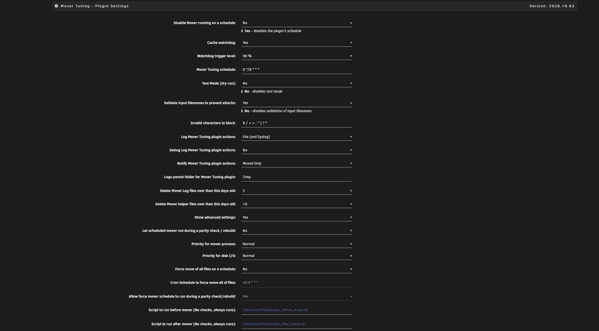
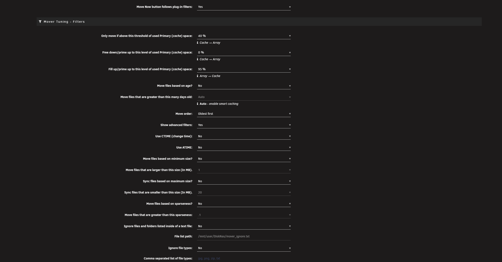
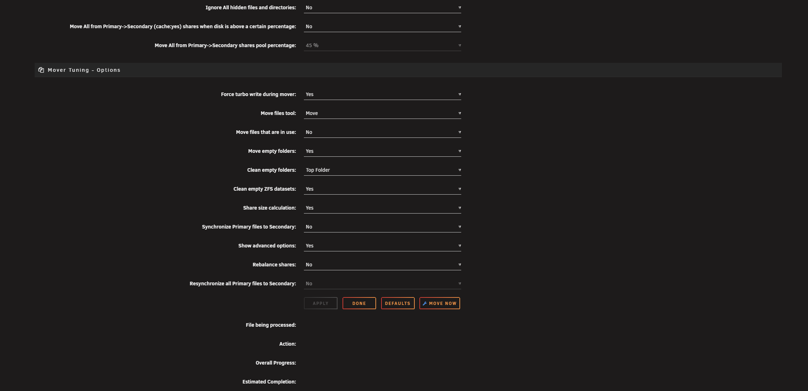
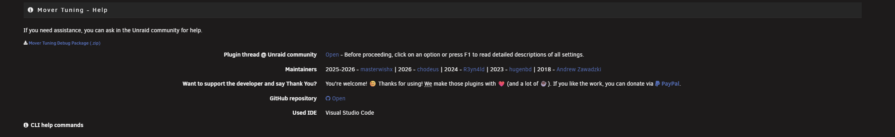

# Mover Tuning

## About

This is an [Unraid](https://unraid.net/) plugin that lets you fine-tune the operation of the [mover](https://docs.unraid.net/unraid-os/using-unraid-to/manage-storage/cache-pools/#using-mover).

This fork merges all [pull requests](https://github.com/R3yn4ld/ca.mover.tuning/pulls) from [R3yn4ld](https://github.com/R3yn4ld/ca.mover.tuning) after review (cosmetics, per-share skipfiletypes merge, automatic age threshold, filename sanitizing, Unraid 7.x compatibility) and adds many new features. See [CHANGELOG.md](CHANGELOG.md) for the full history.

**Requires Unraid 6.9.0-rc2 or newer.** Unraid 7.2.1+ and the 7.4 rc1 are supported (see [Unraid 7.2.1 and newer](#unraid-721-and-newer)).

> **Tip:** click on any option or press **F1** on the settings page to read a detailed description of all settings.

## Features

**When and what to move**

- Only move files if the cache is getting full: *move above* a threshold of used Primary (cache) space, *free down* to a lower level, and *fill up* (Array → Cache) to a chosen level.
- Filter by file age ("Auto" enables smart caching), CTIME or ATIME, minimum size, sparseness, hidden files, file types, or a list of ignored files and folders in a text file.
- **Move order:** oldest, largest or smallest first.
- Optionally move all files from Primary → Secondary (cache:yes) shares when the pool is above a chosen percentage.
- **Cache watchdog** (opt-in): monitors the cache and starts a run when the pool reaches a trigger level.
- Optionally don't run the scheduled mover during a parity check / rebuild.
- Optionally force a move of all files on a schedule, or disable the scheduled run completely.
- Files that are in use are left where they are, unless you enable "Move files that are in use".
- Choose the file-moving tool: Move (Unraid's built-in utility) or Rsync. Optionally force turbo write and set the priority of the mover process and of disk I/O.

**Shares**

- Per-share overrides of the global settings (Shares → click a share → Mover Tuning). Every override has a "Use global" choice.
- Cache:prefer shares: array → cache moves up to a configurable fill-up level.
- Rebalance, Resynchronize and Synchronize Primary files to Secondary (with an optional maximum file size). "Run once" options reset themselves after the run.
- Moving between pools (Unraid 7+).
- Ignore list and ignored file types (with wildcard support) also work for cache:prefer shares and `/mnt/user` paths.
- Hardlinked files are moved and synced together.
- "Share size calculation" option to avoid slow scans on large or busy shares.

**Cleanup**

- Optional moving and cleanup of empty folders, including top-level share folders.
- Cleanup of empty ZFS datasets, with protection for ZFS datasets and `.placeholder` files.

**Safety, logging and troubleshooting**

- Test Mode (dry run) with clear warnings.
- Optional filename validation with a configurable list of blocked characters.
- Live progress of a run (file being processed, action, overall progress, estimated completion).
- Detailed logs (file only, or file and syslog), configurable log folder and log age, and a "Run by" entry showing whether the run came from cron, the CLI or the web UI.
- The log explains why a file did not move (for example "No space left on device") and warns when a share's minimum free space is smaller than the largest file to move.
- Unraid notifications for failures and completion, with a "Moved Only" option.
- Optional scripts to run before and after the mover.
- Debug package (.zip) for the support thread, with file names hidden.
- "Defaults" button that asks first and then resets all settings, including schedules.

**Unraid 7.2.1+**

- Own Mover Tuning schedule, separate from the native mover, with automatic migration of the old schedule.
- "Move now" button that shows the mover as running until it finishes.

**Languages:** English, Russian, German, French and Simplified Chinese.

## How it works

First it checks if it's valid for this script run: there must be a cache disk present and an instance of the script must not already be running.

Next, it checks each of the top-level directories (shares) on the cache disk.
For all shares with the 'Use Cache' setting set to "prefer" or "yes", we use 'find' to create a filtered file list of that share directory.
For all shares with the 'Use Cache' setting set to "only", we use 'du' or 'zfs list' to get the total size of that share directory.

The list is sorted by "Use cache", increasing age, pool, and file inode, giving priority for being on cache to "cache only" shares, then "cache prefer" by moving newest from array to cache and older to array, and finally to "cache yes" shares by moving only from cache to array.
Please note that if the age setting is set to something other than "Auto (smart cache)", this script is actually dumb: it does not check for size and free space and relies on your own calculations.
Files at the top level of the cache or an array disk (i.e. not in a share) are never moved.

The list is then passed to the original Unraid mover.
For each file, if the file is not "in use" by any process (as detected by the 'fuser' command), then the file is moved and, upon success, deleted from the source disk. If the file already exists on the target, it is not moved and the source is not deleted. All metadata of moved files/directories is preserved: permissions, ownership, extended attributes, and access/modified timestamps.
If an error occurs while copying a file, the partial file, if present, is deleted and the operation continues on to the next file.

## Changelog
- 2026.10.26
    - new: Small files move several times faster. The check for files in use took about half a second per file on a busy server; small files are now checked 200 at a time. Big files, hardlinked files and any batch in which a file is open keep their own check, and a batch answer is trusted for 5 seconds at most.

- 2026.10.25
    - new: While a run is being planned, the progress rows under the Move button name the current step (the share being scanned, sorting, the in-use and hardlink checks, planning) instead of only "Calculating". Planning a large share can take several minutes.

- 2026.10.23
    - new: Merged upstream masterwishx 2026.10.17 (201 commits). **_(masterwishx, chodeus)_**
    - new: Optional cache watchdog that starts a run when the cache fills up (off by default), scripts to run before and after the mover, and a Move order setting (oldest, largest or smallest first).
    - new: Unraid 7.4 support: Mover Tuning runs show their progress under the Move button.
    - new: Share overrides get a "Use global" choice for every setting. Existing overrides are unchanged.
    - fix: Open files are detected without the kernel call trace seen on Unraid 7.2.8.
    - fix: Plugin updates now always install the new package. A same-day letter release (for example 2026.09.28 to 2026.09.28a) could be skipped before.
    - fix: Duplicate removal works. A file present on both the cache and the array was never deduplicated (also in upstream).
    - fix: Array-only shares no longer get a log warning suggesting to remove their share config.
    - fix: Removing the plugin restores the original Unraid mover on every Unraid version.

- 2026.10.14
    - fix: Hardlinked files covered by a Disk Priority Mapping are moved again. Each name of a hardlinked file was routed to a disk on its own, so the names could be planned for different disks; the mover then refused to split the group and left all of it on the cache on every run. On the maintainer's server this stranded 281 GB. All names of a hardlinked file now go to the disk chosen for the first one.

- 2026.09.28a
    - fix: When every disk in a Disk Priority Mapping is full and the mapping already lists every array disk, the files stay on the cache with a single log line, instead of each one failing with "No space left on device". Mappings that list only some disks still fall back to the rest of the array.

- 2026.09.28
    - new: Merged upstream masterwishx 2026.09.28. Files that a process has open, including memory-mapped files, are left on the cache instead of being moved (setting "Move files that are in use", off by default). **_(masterwishx, chodeus)_**
    - new: Every file is checked after the transfer, so the failure notice lists only files that really did not arrive. Files that disappear before their turn are no longer reported as rsync errors.
    - new: German, French and Simplified Chinese translations (from upstream).
    - fix: The forced move schedule runs Unraid's own mover again, now with its own parity option, turbo write and priorities. Upstream's version would have started Mover Tuning on this build.
    - fix: Updating the plugin while the mover is running no longer stops the install halfway.

- 2026.09.19
    - new: The plugin interface can now be translated, and a Russian translation is included (from upstream).
    - new: Hardlinked files are handed to the Unraid move utility as a complete group, so a set of hardlinks is no longer skipped when only part of it was selected for one run.
    - fix: Rows in the internal action list are now matched field by field. Previously a filename containing a pipe character could match a different row than its own, and in the case of a hardlinked file that could pass the safety check and act on the wrong list of names.
    - fix: Duplicate files present on both the cache and the array were never being deduplicated. The check that detects them was reading the priority-mapping column instead of the file path, so it never matched and the whole deduplication step was skipped without any message.
    - fix: Priority disk mappings, the ignore list and the duplicate check all read the file path from the correct column again. A mismatch here silently routed files by the wrong value.
    - fix: A failed synchronisation no longer advances the last-sync date. Previously a sync that reported an error could still move the date forward, so the affected files were never reconsidered on later runs.
    - fix: Names containing a line break are skipped rather than trusted, and paths passed to stat are quoted, so a name containing a quote character no longer breaks the age and access-time lookups.
    - fix: File extensions in the Skip File Types field are escaped before use, so an extension containing a quote character can no longer break the file scan.

- 2026.09.10b
    - fix: Updating the plugin could abort halfway and leave the old version installed while the Plugins page reported it as up to date. The check for a running mover matched the plugin installer's own process, so an update could cancel itself, and because the version number is recorded before that check runs there was no way to retry from the UI. The check now uses the mover's own run-state file, and also clears a stale file left behind by a stopped run.
    - fix: The diagnostics package no longer blanks out Disk Priority Mappings and the Ignore List. Both settings pack several paths into one value, and the anonymizer treated the whole value as a single path, erasing the separators and the disk names along with it. Folder names are still hidden; the structure and the target disks are now readable.
    - fix: The pipe character is no longer treated as an invalid filename character by default. It was only unsafe because such names were cut short in the internal file lists, which was fixed in 2026.09.10a. Servers that already have a saved invalid-character list keep it unchanged.

- 2026.09.10a
    - fix: Files whose name contains a pipe character were never moved. The file list is pipe-delimited, so such a name was cut short at the first pipe and the mover then asked rsync to move a path that does not exist. On the maintainer's server this silently stranded 134 files on the cache, failing the same way on every run. Paths are now rejoined before use, so these files move normally and keep their names.
    - fix: The Ignore List and Disk Priority Mappings now match correctly against paths containing a pipe, including a pipe in a folder name. Previously such a path was compared only up to the first pipe, so an ignore entry could fail to match and a priority mapping could route the file to the wrong disk.
    - fix: The last-access and last-change time lookups read the correct file for these names. Previously they read the containing folder, and that timestamp then fed the age filter and the processing order.
    - fix: A file whose name begins with a pipe truncated to its parent folder. With Test Mode off, that could move the entire share and delete the originals, ignoring the Ignore List and the thresholds. No such file existed on the maintainer's server, so this never triggered, but it is now impossible.
    - fix: Move selection now matches the action column exactly instead of searching the whole line, so a file whose name happens to contain an action phrase cannot be picked up for the wrong operation.
    - note: Files with a pipe in the name are still rejected when "Validate filenames" is enabled, because the pipe is in the default invalid-character list. That list is editable in the plugin settings.

- 2026.09.10
    - new: Merged upstream masterwishx 2026.09.07 (89 commits). Mover decisions now track projected pool usage as a signed running total, so each planned move reduces the projected usage that later files are judged against. Threshold evaluation was corrected for all share modes. **_(masterwishx)_**
    - note: Because of that redesign, the sizes reserved by skipped paths, skipped file types, hidden files and the Ignore List no longer hold the mover back from moving other files. On the same input this moves more per run than 2026.08.29 did. Raise the Freeing Threshold if you want the mover to stop earlier.
    - new: Skip lists now match share names exactly, so a share named "media" no longer also matches "media2", and skip lists saved with Windows line endings are read correctly. **_(masterwishx, thanks to chodeus)_**
    - new: Skipped and ignored sizes are measured in exact bytes in a single pass, instead of rounded per-path totals.
    - fix: The Skip Folder List did not escape square brackets, so a folder such as "My [Series]" was never excluded. This list is the only exclusion that applies to cache:only shares and to runs above the Move All threshold.
    - fix: The Skip Folder List also ignored skip files saved with Windows line endings, which left it silently empty.
    - fix: Skip File Types measured the wrong thing. The size lookup never expanded the extension, so it measured the whole share instead of the matching files, and still escapes "!" correctly.
    - fix: The forced move schedule still calls the original Unraid mover (mover.old). Upstream now points it at /usr/local/sbin/mover, which on this build is the plugin itself.
    - fix: Disk Priority Mappings and the Ignore List were re-verified against live data after the merge; behaviour is unchanged.

- 2026.08.29
    - new: Merged upstream masterwishx 2026.08.29. Move decisions now use projected pool usage, tracked per file through filtering, planning and execution, instead of raw cumulative file size. Threshold evaluation was corrected for all share modes (yes, prefer and only). **_(masterwishx)_**
    - fix: Disk Priority Mappings and the Ignore List were rebuilt on upstream's new file list layout, which adds a pool-usage column and moves the file path to the end of each row. Behaviour is unchanged; both were re-verified against live data.
    - fix: Skip File Types still escapes "!" correctly after upstream reworked that block.

- 2026.08.25
    - new: Merged upstream masterwishx 2026.08.21, including the rsync shell-injection fix, the command allowlist, detached web-triggered runs, and the new Share size calculation option. **_(Kamdzy)_**
    - fix: Skip File List was never applied. The lookup read the mover's own stdin instead of the list file, so under cron no skip entry was excluded from the scan and none counted toward the threshold; run interactively it hung waiting on the terminal.
    - fix: Mover now reports "mover: already running" to the mover log and the Unraid notification area again, instead of only to stdout where scheduled runs discard it.
    - fix: Soft stop could never take effect. It was handled after the "already running" check, which exits during exactly the run a soft stop is meant to end.
    - fix: Web-triggered runs logged "Run by: unknown". The run source is now passed explicitly, since detaching the run hides its origin.
    - fix: "Move Now" and the Main page "Move" are described correctly on the settings page. On this build they run Mover Tuning, not the built-in Unraid mover.
    - new: `mover --help` prints the plugin command list instead of exiting silently.
    - fix: `mover start -e diskN` (empty a disk) restored, removed upstream. This build replaces the built-in mover on every Unraid version, so it is the only route to that command.
    - fix: default.cfg is newline-terminated, so Reset no longer produces a malformed last setting.
    - fix: Removed the priority-disk space tracking that never ran, a duplicate ignore-list matcher, and a sort key that pointed at the wrong column. Disk priority mapping and the ignore list are unchanged in behaviour.
    - fix: Removed an unused Move Now handler that started the mover without the parity, already-running and priority checks.
    - fix: Local build wrappers are no longer included in the package.

- 2026.08.21
    - fix: Improved detection of how scheduled and manual mover runs are initiated. *(masterwishx)*
    - fix: Added safer checks to prevent multiple mover processes from running simultaneously.
    - fix: Updated command validation to accept only supported mover commands.
    - fix: Improved startup behavior and process-tracking reliability.
    - fix: Removed unsupported empty-directory move handling.
    - fix: Updated usage information to reflect only supported commands.    
    - new: Web‑triggered mover operations now run fully in the background to keep the interface responsive. *(masterwishx — Thanks to chodeus for this PR fix)*
    - new: Command‑line mover operations continue to wait for completion.
    - fix: Redirected mover output and improved execution-status logging for better reliability.
    - fix: Added validation for mover commands and priority settings before execution.
    - fix: Stop operations continue to run synchronously.    
    - fix: Updated post-install setup to consistently provide the `age_mover` command instead of `mover`. *(Thanks to chodeus for helping to fix)*

- 2026.08.15
    - fix: Safer handling of filenames with spaces and special characters in processTheMoves(). *(masterwishx - Thanks to Joly0 for this PR fix)*
    - fix: Removed unsafe eval; rsync now runs through a proper Bash array for stable execution.
    - fix: Improved dry-run output to better reflect real rsync behavior.
    - fix: Reworked empty-folder cleanup for more predictable and reliable results.
    - fix: Added clear handling when no source files are available.
    - new: Faster and safer path normalization using Bash substitution.

- 2026.06.24
    - new: Improved detection of how mover tuning was started, giving clearer identification of cron, CLI, or web-triggered runs. *(masterwishx)*
    - new: Added a readable "Run by" entry in startup logs for easier troubleshooting.
    - fix: Unified logging format across CLI, web UI, and scheduled runs for consistent output.
    - fix: Enhanced debug log readability for mover-related operations.
    - fix: Corrected missing syslog output for non-cron mover runs (CLI and Web UI now log properly).

- 2026.06.05
    - new: Added a new option "Share size calculation" in Mover Tuning, helping avoid slow scans on large or busy shares. *(masterwishx)*
    - new: Cache reserved-space logic now respects the share-size calculation setting.
    - new: Improved log messages for missing shares or pool folders, with a hint to clean unused shares via the *Shares → Clean Up* button.

- 2026.04.01
    - new: Adjusted wildcard pattern detection logic in file filtering operations. *(masterwishx)*
    - new: Added handling of wildcard patterns in ignored file entries, wildcards now exclude matching files recursively without size tracking. *(Joly0)*
    - new: Enhanced help text for the "Ignore file types" feature with clearer wildcard pattern examples and improved formatting.

- 2026.03.21
    - fix: Corrects the share-root path check to properly clean top-level folders during array → cache moves. *(masterwishx)*
    - fix: Resolves an infinite loop in the empty-folder cleanup logic by fixing the parent-directory stop condition during array → cache moves. *(atipapp)*

- 2026.02.27
    - new: Smarter empty-folder cleanup — now removes only truly empty parent folders after a move, with improved tracking and safety checks. *(masterwishx)*
    - new: Added protection for ZFS datasets and ".placeholder" files to avoid deleting system-critical or intentionally preserved folders.
    - new: Split cleanup logic into per-folder and top-level share cleanup for clearer, more predictable behavior.
    - fix: Improved mover logging with clearer messages for file vs. folder actions and more accurate end-of-run summaries.
    - fix: Updated mover scheduling logic for Unraid 7.2.1+, including better enable/disable handling and compatibility with older "mover.cron" setups.
    - fix: Strengthened error handling in cron updates with clearer success/failure reporting and safer fallback behavior.
    - new: Increased reliability of empty-folder cleanup, especially for deep directory structures, ZFS datasets, and other edge-case scenarios.

- 2026.02.21
    - fix: Resolved syslog spam by refactoring mover logging to honor "LOGMODE" and "DEBUGMODE" settings. *(masterwishx)*
    - new: Added ZFS mountpoint checks to suppress rmdir errors and safely skip ZFS-backed directories during cleanup.
    - new: Improved UI with season-aware New Year notice, dynamic year rendering, and updated icon styling.
    - new: Enhanced logging options in the UI ("File (and Syslog)" vs "File Only") for clearer behavior.
    - fix: Updated copyright and README year ranges to 2025-2026.
    - fix: Corrected top-folder cleanup to use the share's actual top-level path.
    - fix: Improved sparseness filtering and numeric formatting for clearer file listings. *(Ben64)*

- 2025.12.26
    - fix: Added mutual-exclusion between CTIME/ATIME and age-based controls with automatic initialization. *(masterwishx)*
    - new: Collapsible CLI help panel with toggle to reveal/hide command details.
    - new: Added dismissible New Year notice and dynamic plugin year rendering across the UI.
    - new: Expanded inline help for logging, debug, top-folder, and related options.
    - fix: Wording, spacing, and layout refinements for improved clarity.

- 2025.12.21
    - fix: Refactored mover workflow and file list logic for cleaner code. *(masterwishx)*
    - fix: Fixed variable expansion issue in file list checking to prevent word-splitting/empty-string errors. (Thanks to RyanWarwick)
    - fix: Enhanced mover scheduling workflow with updated binary path references.
    - fix: Improved symlink creation logic and plugin messaging for better consistency.
    - fix: Migration added to update existing scheduled tasks to use the mover start command with migration logging.
    - new: UI updated with version-aware guidance, duplicated CLI help panels, and responsive styling.

- 2025.12.13
    - fix: Fixed Firefox button responsiveness issue where clicking did not trigger the mover. *(masterwishx)*
    - new: New mover control UI with Start button, spinner, status text, and wrench indicator that reflects running state; disables while running and re-enables on errors.
    - new: DOMContentLoaded-driven flow with immediate status checks and polling to detect completion and refresh the page.
    - fix: Improved error handling, failure counter, and cleanup on page unload to avoid polling leaks.

- 2025.12.10
    - new: Added version-aware help text for CLI commands. *(masterwishx)*
    - new: Implemented safety checks during installation to prevent conflicts with running processes.
    - fix: Enhanced installation and removal workflows with comprehensive cleanup and restoration logic.
    - doc: Clarified CLI usage instructions and mover command guidance for end-users.

- 2025.12.09
    - new: Added support for Unraid 7.2.1+, handling breaking changes so Mover Tuning works alongside the native mover while remaining compatible with older versions. *(masterwishx)*
    - new: Configurable Mover Tuning schedule input with inline help (v7.2.1+).
    - new: “Move now” button to start the tuning mover from the UI and live “Mover is running” indicator.
    - new: Persistent breaking-change notice banner with dismiss functionality and contextual guidance for v7.2.1+.
    - new: Dual cron management — separate schedules for Unraid's native mover and Mover Tuning, with migration of legacy schedules.
    - new: Version detection & conditional logic — core files and UI elements gated based on Unraid version.
    - new: Post-install migration script detects old dynamix mover schedules, creates mover.tuning.cron, and renames old mover.cron.
    - new: UI updates — new cron schedule field, warning if shareMoverSchedule conflicts, version-aware mover execution.
    - fix: Displays current mover running state and updates status/help text dynamically.
    - fix: Version-aware cron handling; tuning cron can be saved and synchronized.
    - fix: Cleanup of legacy files and configurations to prevent conflicts.

- 2025.11.28
    - new: Added "Move empty folders" option to the WebUI (moveEmptyFolders="yes" by default) to control whether empty directories are moved along with files. *(masterwishx)*
    - new: Automatic empty-folder cleanup for rsync, removing source directories that become empty after file moves (when enabled).
    - new: Enhanced logging: Added separate logging for files and folders throughout the move process to improve visibility.
    - new: Improved UI layout by removing unnecessary style wrappers and adding informational icons.
    - new: Added responsive WebGUI behavior by removing "narrow" CSS classes from multiple select elements, improving styling consistency for Mover.tuning and Share.tuning pages.
    - new: Updated filter logic in createFilteredFilelist() to properly handle inclusion/exclusion of empty folders.
    - new: Updated and clarified Test Mode warnings and notification behavior.
    - fix: General bug fixes and minor improvements.

- 2025.11.23
    - new: Added support for moving empty folders from primary storage when the mover runs. *(masterwishx)*
    - new: Added automatic disk-emptying using code from the stock Unraid mover after custom mover operations.
    - new: Added event-aware Discord notifications for releases, PRs, issues, workflow runs, and manual triggers.
    - new: Added per-share ATIME option.
    - new: Added folder-aware tracking and explicit file vs. folder markers in status, statistics, and action output.
    - new: Added FILETYPE column to the file list to distinguish folders from files.
    - new: Added error handling for CRLF to LF line-ending conversion when processing the ignore list.
    - new: Added external status badges to the README.
    - fix: Improved warning styling, safer path handling, and updated example file-path text.
    - fix: Debug run now captures stderr and uses an increased timeout.
    - fix: General bug fixes and minor improvements.

- 2025.10.31
    - fix: Added guard to skip cache:prefer pools when no valid secondary paths exist to avoid erroneous processing. **_(masterwishx)_**
    - new: Improved handling of secondary storage in cache-prefer mode for accurate counts, presence checks, path selection and clearer error/log messages.
    - new: Dynamic Test Mode warning that displays when Test Mode is enabled.
    - new: Refreshed option layout, wording and help text for clearer presentation and consistency.

- 2025.10.22
    - new: Test mode now defaults to "no" - moves will execute immediately unless explicitly set to test mode. **_(masterwishx)_**
    - new: Per-share override support: per-share configs are detected and applied when present.
    - new: Rebalance activation treats any non-"no" value as active and normalizes "run-once".
    - new: Stats and headers now include unattended totals and per-share metrics.
    - fix: Clarified UI help text and fixed wording.
    - new: Added "run-once" option - automatically resets to "no" after execution.
    - new: Improved unattended storage detection during rebalancing.
    - new: Enhanced logging for attended/unattended pools.
    - new: Impact: More granular control over rebalancing operations.
    - new: Reads per-share configs from MOVERTUNING_OVERRIDE_CFGFOLDER/sharename.cfg.
    - new: Enhanced AWK logic to apply per-share configurations.
    - new: Global defaults preserved when overrides not present.
    - new: Impact: Each share can have custom routing rules, preventing misrouting.
    - new: Added "(ignores plugin filters)" clarifications for Force move and Move Now.
    - new: Added "Run once" option for rebalance shares.
    - new: Fixed duplicate wording errors.
    - new: Updated help text for Unattended Storage and cache conditions.
    - new: Impact: Better user understanding of filter behavior.
    - new: Added unattended storage metrics: FILES_FROM_UNATTENDED, SIZE_FROM_UNATTENDED.
    - new: Extended status output with per-share metrics.
    - new: Improved rebalance operation logging.
    - new: Impact: Better visibility into mover operations.
    - new: Files are routed according to per-share configurations.
    - new: Plugin paths are properly filtered and not sent to cache root.
    - new: Share-specific rules prevent creation of unintended shares.
    - new: Unattended storage is properly detected and handled.
    - new: Fully reworked cache:prefer share path detection and handling.

- 2025.10.03
    - new: Configurable blocked-filename characters with sensible defaults, persisted across runs. **_(masterwishx)_**
    - new: Input and placeholders for invalid-character list and several path/script fields for clearer configuration.
    - new: More accurate path-traversal and filename validation to better block unsafe paths.
    - new: Improved filename and path validation to better detect and block unsafe names and traversal patterns.
    - fix: Per-share sync override awareness for share-specific behavior.

- 2025.09.06
    - new: Implemented disk priority mapping, allowing the user to choose the preferred disk to which the files will move to based on their path **_(Kamdzy)_**
    - new: Implemented an ignore list feature to exclude specific files or directories from being moved to array

    - new: Added Unraid 7.2 responsive UI support. **_(masterwishx)_**
    - new: Integrated multi-language options for better usability.
    - new: Implemented broad localization for some labels and help text.
    - fix: Corrected cron time updates when force move is enabled.
    - new: Provided a Crontab link for easier using of the force scheduler.
    - new: Implemented a warning notification system when test mode is enabled, along with additional improvements for notifications.
    - fix: Adjusted size calculation to correctly ignore hidden files.
    - new: HTML-escaped all displayed input values for security.
    - new: Set external links with safer attributes.

- 2025.08.05
    - new: Updated unraid mover code from original mover for "mover start -e" command. **_(masterwishx)_**
    - fix: Enhanced folder cleanup logic to prevent errors by checking folder existence before removal.
    - fix: Added diagnostic logging for folder cleanup operations to improve troubleshooting.
    - new: Clarified help text for the "Sync files based on maximum size?" option to specify it applies only when Synchronize or Resynchronize features are enabled.
    - new: Expanded and reformatted explanatory notes for "Synchronize Primary files to Secondary," detailing conditions for file synchronization and eligibility.

- 2025.07.28
    - new: Added a configurable option for global and share-only sync files based on maximum file size in MB. **_(masterwishx)_**
    - new: Updated UI text to clarify size units for both moving and syncing files.
    - new: Added explanatory text for the new sync size selection to guide users.

- 2025.07.27
    - new: Added a "Moved Only" notification option that allows notifications only when files are actually moved. **_(masterwishx)_**
    - new: Debug added for synchronize and notification modes.
    - new: Introduced a "Synchronize Primary files to Secondary" setting for shares override with cache enabled, enabling selective synchronization of modified files for backup and parity protection.

- 2025.06.14
    - fix: Fix age_mover is missing the "start" parameter in the cron schedule when force move is enabled. **_(masterwishx)_**
    - fix: Remove renaming of "mover.cron" to "mover.cron.disabled". No longer necessary with previous version.

- 2025.06.07
    - fix: Fixed "mover start" from CLI freezing before the end stage at "resetRunOnceMoverSettings" function. **_(masterwishx)_**
    - fix: Fixed the mover process retrieving blank values for parent processes instead of "bash" and "crond" commands.
    - new: Added a time counter feature to calculate the elapsed time during file move operations. This enhancement provides better visibility into the performance of file moves.

- 2025.06.01
    - new: Added an option "Move files tool" to select the file-moving tool between Rsync and the Unraid move utility, default file-moving tool set to Rsync. **_(masterwishx)_**
    - new: Introduced a new debug command "mover debug" to generate a diagnostics package for troubleshooting.
    - fix: Enhanced logging and debug information for file move operations.
    - fix: Updated debug package creation to copy the diagnostics ZIP to the system boot logs directory.

- 2025.05.23
    - fix: Fixed "mover start" issue that was scheduled without the "start" parameter by unRaid 6.x. **_(masterwishx)_**
    - new: Added "Top Folder" option for the Clean empty folders feature to remove top-level empty folders on shares.
    - fix: Removed warning message when thresholds are equal and both set to 0%.
    - fix: Enhanced README and plugin with clearer descriptions of plugin functionality, including expanded options and improved usage explanations.
    - fix: Improved disk validation to ensure only mounted disks matching the required pattern are accepted, with clearer error messages and usage instructions.

- 2025.05.04
    - fix: Fix for initialized PREFER_MOVINGPCTTHRESHOLD to 0. Thanks to AdamLeyshon for reported this issue. **_(masterwishx)_**
    - new: A warning will be added when in test mode and thresholds are either identical or have a small gap between them.
    - new: Debug download added that collect all data from plugin and save them to a file for debugging purposes. Thanks to Rysz from forums for the code example.
    - fix: Fix issue where "shareOverrideConfig" with spaces was not working with "grep".
    - fix: Fix for enabling/disabling Mover running on a schedule.

- 2025.04.24a
    - fix: version number in default.cfg file. **_(masterwishx)_**

- 2025.04.24
    - fix: Fix cli arguments when running "mover command" in cli mode for pass them to age_mover script or original mover. **_(masterwishx)_**
    - new: Add "mover start -e diskX" option for age_mover from original mover for empty an array disk.
    - new: Added "mover reset" command to reset all settings in the plugin. This will delete also override existing settings.
    - new: Added a "Defaults" button in the GUI that resets all settings to their default values. This action triggers "age_mover reset" via "reset.php".
    - fix: Updated plugin version handling to ensure it is stored in the config with quotes and displayed correctly in both the console and logs.
    - fix: Schedule option to force move all files by unraid mover now logs output via syslog instead of being unlogged. Thanks to williechan91 for reported this issue.
    - fix: Fix the calculation of PRIMARYSIZETHRESH in cache prefer cases where the threshold can become negative due to freeing thresholds without moving any files. Thanks to AdamLeyshon for reported this issue.

- 2025.04.05
    - fix: Fix for Logs parent folder can be empty instead of /tmp when no value is provided. Thanks to niwmik2 from forums for reported this issue. **_(masterwishx)_**
    - fix: Fixed an issue where (cache:prefer) was generating unnecessary lists for files that should remain on the primary pool.
    - fix: Only generate updated filtered filelist for (cache:prefer) if we have files on secondary storage.
    - new: Added Help block to the plugin page, including useful links and a donation link for support. Thanks to KluthR from forums for the code example.

- 2025.03.30
    - new: Added new settings: Logs parent folder, age for mover Log,txt and List files. Thanks to Renegade605 and jimlei from forums for the idea. **_(masterwishx)_**
    - fix: Log Mover Tuning plugin actions setting when set to No, will not post to syslog and Mover_tuning_xxx.log file.
    - fix: Added a counter when deleting folders and datasets to speed up the counting of files after moving a large number of files. Thanks to Dor from the forums for the idea.
    - fix: Ensure Folders are always deleted when setting "yes" to clean folders after moving.
    - new: Added debug when deleting folders and datasets in order to get more information about the process.

- 2025.03.20a
    - fix: Exclude primary storage from find in Move now button in cache:prefer share page , when moving all data from array to cache pool by unraid mover. **_(masterwishx)_**

- 2025.03.20
    - fix: Added zfs cache:only share calculation when share is folder instead of dataset. Thanks to Sak from forums for the bug report. **_(masterwishx)_**
    - fix: Added remove potential trailing ( \/, \*, \/\* ) characters from the skipped folder path in ignore file list path.
    - fix: Fixed issue when thresholds for cache:prefer was applyed to cache:yes shares. Tnanks to Ichthus and other users from forum for the bug report.
    - new: Added fillup (%) global setting threshold option and override for cache:prefer shares.
    - new: Move now button in cache:prefer share page , moving all data from array to cache pool by unraid mover.

- 2025.03.11
    - Fixed zfs cache pool percent calculation. Thanks to Renegade605 from forums for the bug report. **_(masterwishx)_**
    - Array -> Cache (cache:prefer) now moves data to the cache pool from the array only until reaching a fillup limit of 95%.
        - Thanks to alturismo and Renegade605 from forums, who helped clarify how this feature should work.
        - Disabled override setting for mover tuning if shareUseCache="prefer" (Array->Cache) is set.
    - Format global and share settings help text descriptions add more clear description for mover thresholds.
    - Fixed ignore file list path setting when folder in list file contains ([). Thanks to JamieBriers from forums for the PR and fix.

- 2025.03.04
    - Added option for users can enable/disable Validation (Sanitize) check for input filenames to prevent attacks future added befor. **_(masterwishx)_**
    - Fixed Debug = yes/no instead of 0/1 in mover logs.
    - Fixed primary cache prefer not to move data. Set fixed moving threshold to 99% freeing threshold to 0% for skip moving.
      when chache is full set freeing to 98% to move some data. Maybe better fix will be later.

- 2025.03.01
    - [Fix for [*] in path when cache prefers or RebalanceShare. Thanks to [tehg] from the forums for identifying the bug](https://github.com/masterwishx/ca.mover.tuning/pull/7) ([masterwishx](https://github.com/masterwishx)).
    - Fix for Clean empty ZFS datset when enabled but Clean empty Folders is disabled.
    - Added Sanitize check for input filenames to prevent attacks. Thanks to [AEnterprise] from forums for identifying the bug.
    - Plugin icon changed.

- 2025.02.24
    - [Added log message when no share avalible on cache for ZFS dataset.](https://github.com/masterwishx/ca.mover.tuning/pull/7) ([masterwishx](https://github.com/masterwishx)).
    - Added option with Notifications to Unraid GUI for error and success messages.
    - Fixed issue with (') symbol in ignore File list. Thanks to JayBriers from forums.
    - ATIME option is now added for based on age option.
    - Debug Logging option added (To print find command and ignored folders/files)

- 2025.02.18.1752
    - [Check parent empty ZFS dataset for children empty datasets before destroy it.](https://github.com/masterwishx/ca.mover.tuning/pull/1) ([masterwishx](https://github.com/masterwishx))
    - Shell Check Fixes + speedup `if` checks.
    - Better help text cosmetic with Bold and italic + added note for Test Mode and some changes in config page.
    - Skip cache pool size calculation when only one share found in cache pool.
    - Changed minimum threshold of used Primary (cache) space from 5% to 0%.

- 2025.02.13
  - Force ignore folders matching 'tdarr-cache'
  - Force ignore folders matching 'Downloads/wanted'
  - Force ignore folders matching 'Downloads/incomplete'
  - Added support for removing trailing slashes in skip files
  - Fixed parsing of file types in skip files
  - Changed 'Move Now' button to trigger the plugin mover (age_mover)
  - Fixed a bug that would break the FINDSTR if an extension has ! in the name

- 2025.02.12.1707
    - [Fix issue for shares with spaces](https://github.com/R3yn4ld/ca.mover.tuning/pull/69) Thanks [DToX_](https://forums.unraid.net/topic/176951-mover-is-refusing-to-move-any-files-off-the-cache-from-a-share-with-a-space-in-the-name/#findComment-1521811) from forums. ([masterwishx](https://github.com/masterwishx))
    - [Add option to clean ZFS datasets](https://github.com/R3yn4ld/ca.mover.tuning/pull/69) ([masterwishx](https://github.com/masterwishx))
    
- 2024.09.05.0222
  - [Fix find not finding hidden files](https://github.com/R3yn4ld/ca.mover.tuning/pull/67) Thanks to [solidno8](https://forums.unraid.net/topic/70783-plugin-mover-tuning/?do=findComment&comment=1461454) from forums. ([R3yn4ld](https://github.com/R3yn4ld))
- 2024.09.05.0115

  - Add compatibility with unraid 7.x for share_mover ([R3yn4ld](https://github.com/R3yn4ld))
  - [Fix "integer expression expected"](https://github.com/R3yn4ld/ca.mover.tuning/pull/63/commits) Thanks to: ([RonaldJerez](https://github.com/RonaldJerez))
  - Fix "0: command not found" bugs ([R3yn4ld](https://github.com/R3yn4ld))

- 2024.08.18

  - [Fix blank grep to rsync loop causing "Warning no action for; integer expected; unary operator expected" errors](https://github.com/R3yn4ld/ca.mover.tuning/tree/Fix-no-action-for-blank-integer-unary) ([R3yn4ld](https://github.com/R3yn4ld))

- 2024.08.17

  - [Fix settings override not reverting](https://github.com/R3yn4ld/ca.mover.tuning/tree/Fix-settings-override-not-reverting) ([R3yn4ld](https://github.com/R3yn4ld))
  - [Better empty folder cleaner](https://github.com/R3yn4ld/ca.mover.tuning/tree/Better-emptyfolder-cleaner) ([R3yn4ld](https://github.com/R3yn4ld))

- 2024.08.15

  - [Fix ignore list reserved space](https://github.com/R3yn4ld/ca.mover.tuning/tree/Fix-ignore-list-reserved-space-) double quoting (Thanks silver226 see [forum post](https://forums.unraid.net/topic/70783-plugin-mover-tuning/?do=findComment&comment=1454141)) ([R3yn4ld](https://github.com/R3yn4ld))
  - [Better empty folder cleaner](https://github.com/R3yn4ld/ca.mover.tuning/tree/Better-emptyfolder-cleaner) ([R3yn4ld](https://github.com/R3yn4ld))
    - Rewritten to rmdir parent directory of a moved file if empty (drawbacks: will let multidirectory dirs alive)
    - Added option to enable/disable empty folder cleaner added in Settings UI
    - UI improvements, settings sorted
  - Even [Better cache priming](https://github.com/R3yn4ld/ca.mover.tuning/tree/better-cache-priming) (hopefully) ([R3yn4ld](https://github.com/R3yn4ld))
    - Rewriten Ignore filelist from file and filetypes filtering functions (major)
    - Improve calculating size of filtered files and filetypes
    - Update calculation from basic/bc to numfmt. Removed bc option
    - Added verification for not breaking hardlinks when an hardlinked file is filtered
  - Added testmode to cleaning empty folder function, and a min depth of 2.
  - [Fix ctime bug](https://github.com/R3yn4ld/ca.mover.tuning/tree/Fix-ctime-bug) ([R3yn4ld](https://github.com/R3yn4ld))

- 2024.08.12

  - [Repair/optimize cache priming](https://github.com/R3yn4ld/ca.mover.tuning/tree/Better-cache-priming) ([R3yn4ld](https://github.com/R3yn4ld)).
  - Adding check to bc (un)installation routine
  - [Add bc (un)install option](https://github.com/R3yn4ld/ca.mover.tuning/tree/bc-nerdtools-dependancy) ([R3yn4ld](https://github.com/R3yn4ld))
  - Force test mode only on major upgrade, keep on minor ([R3yn4ld](https://github.com/R3yn4ld))
  - [Better cache priming](https://github.com/R3yn4ld/ca.mover.tuning/tree/better-cache-priming) ([R3yn4ld](https://github.com/R3yn4ld))

- 2024.08.11

  - [Allow operation without array if multiple pools](https://github.com/R3yn4ld/ca.mover.tuning/tree/Allow-operation-without-array-if-multiple-pools) ([R3yn4ld](https://github.com/R3yn4ld)): Fixed fatal error bug
  - Fixed error message about mover.pid and softstop file when installing the plugin or booting Unraid

- 2024.08.10

  - [Better filtering with ctime=no](https://github.com/R3yn4ld/ca.mover.tuning/tree/Better-method-for-filtering-with-ctime-%3Dno) ([R3yn4ld](https://github.com/R3yn4ld))
  - [Improved Synchronization](https://github.com/R3yn4ld/ca.mover.tuning/tree/Improve-synchronizing-from-secondary-to-primary) ([R3yn4ld](https://github.com/R3yn4ld)):
    - Improve synchronization by looking for files on cache first
    - Do not count synchronized files twice (freeing/priming target were half achieved)
    - Optimize Filtering File and Decision loops regarding Rebalance and Synchronize
  - Moved test mode on top of Mover Tuning Page
  - Add check for primary storage not existing (dust config files)

- 2024.08.07

  - Fix bug introduced by "Allow operation without array if multiple pools" preventing mover to run if less than 2 pools installed.
  - 2024-08-07
  - [Allow operation without array if multiple pools](https://github.com/R3yn4ld/ca.mover.tuning/tree/Allow-operation-without-array-if-multiple-pools) ([R3yn4ld](https://github.com/R3yn4ld)) Unraid 7.0.0.beta2 may be required for this to work (6.x gui might not allow to have pool as Primary and Secondary)
  - [Add cleanup empty folder function](https://github.com/R3yn4ld/ca.mover.tuning/tree/Add-cleanup-empty-folders) ([R3yn4ld](https://github.com/R3yn4ld)): Will delete empty folder if file have been moved.

- 2024.08.06

  - [Bug fixes](https://github.com/R3yn4ld/ca.mover.tuning/tree/2024-08-06-release5) ([R3yn4ld](https://github.com/R3yn4ld))
    - Resynchronize not working for share below moving threshold.
    - Internal mover moving files from Secondary to Primary instead of syncing (you may Resynchronize to correct the effect)
  - [Added Resynchronize all Primary files to Secondary option](https://github.com/R3yn4ld/ca.mover.tuning/tree/Resync-shares) ([R3yn4ld](https://github.com/R3yn4ld)): Resynchronize all Primary files to Secondary. This will resynchronize the Primary (cached) files on both Primary and Secondary (array) so they are backed up and parity protected. All files will be synchronized again independently of modification time. This can be a long operation. Run-once setting will reset back to No after next run
  - Minor bug fixes and improvements ([R3yn4ld](https://github.com/R3yn4ld))

- 2024.08.05

  - [Rebalance shares](https://forums.unraid.net/topic/92126-smart-caching-script/) ([R3yn4ld](https://github.com/R3yn4ld)): Enhance previous "Repair Primary" option. Renamed it "Rebalance shares". This will move files from shares to their primary and secondary storage if spread elsewhere. May imply moving older files from Primary->Secondary or Secondary->Primary if allowed (cache:prefer or cache:yes) to free some space.
  - Bug fixes ([R3yn4ld](https://github.com/R3yn4ld))

- 2024.08.04

  - [Unraid 7.0.0 beta2 Secondary storage Compatibility](https://github.com/R3yn4ld/ca.mover.tuning/tree/Unraid-7.0.0-Secondary-storage-Compatibility) ([R3yn4ld](https://github.com/R3yn4ld)) minor enhancements (6.12 mover action naming) and... can now move between pools (tested on 7.0.0-beta2) !
  - [Fix find not ignoring hidden files](https://github.com/R3yn4ld/ca.mover.tuning/tree/Fix-find-not-ignoring-hidden-files) ([R3yn4ld](https://github.com/R3yn4ld)) ([Thanks to helpful-tune3401](https://forums.unraid.net/topic/70783-plugin-mover-tuning/page/65/#comment-1449644))
  - [Fix default Settings handling causing a "Unary operator" bug](https://github.com/R3yn4ld/ca.mover.tuning/tree/Fix-unary-operator-bug) ([R3yn4ld](https://github.com/R3yn4ld)) ([thanks to Alturismo](https://forums.unraid.net/topic/70783-plugin-mover-tuning/page/64/#comment-1449175))
  - [Add freeing threshold option](https://github.com/R3yn4ld/ca.mover.tuning/tree/Add-freeing-threshold-option) ([R3yn4ld](https://github.com/R3yn4ld))

- 2024.08.01

  - [Deleted share error control and SoftStop improvement](https://github.com/R3yn4ld/ca.mover.tuning/tree/deleted-share-error-control) ([R3yn4ld](https://github.com/R3yn4ld))

- 2024.07.30

  - [Various bug fixes](https://github.com/R3yn4ld/ca.mover.tuning/tree/2024.07.29-various-bug-fixes) ([R3yn4ld](https://github.com/R3yn4ld)) ([Freender](https://github.com/freender))
  - [Enhance internal mover function](https://github.com/R3yn4ld/ca.mover.tuning/tree/Enhance-processTheMove-function) ([R3yn4ld](https://github.com/R3yn4ld))

- 2024.07.29

  - [Automatic Array to Cache](https://github.com/R3yn4ld/ca.mover.tuning/tree/automatic-array-to-cache)
  - Complete rewrite of file listing functions (find, decide to move..) ([R3yn4ld](https://github.com/R3yn4ld))
  - [Fix an issue with inaccurate capacity when raid z1 is used](https://github.com/R3yn4ld/ca.mover.tuning/pull/9/) Updated zfs functions getting usage of a pool ([Freender](https://github.com/freender))
  - Added cache mode "prefer" smart moving in "Automatic age" mode ([R3yn4ld](https://github.com/R3yn4ld))
  - Added option to "repair" Cache:Only (moving everything on share to cache) and Cache:No (moving everything on share to array) shares ([R3yn4ld](https://github.com/R3yn4ld))
  - Added option to synchronize Cache:Yes and Cache:Prefer shares to array so data are parity protected ([R3yn4ld](https://github.com/R3yn4ld))
  - Turbo write mode forcing improvement to not wake spinners if not needed ([R3yn4ld](https://github.com/R3yn4ld))
  - UI improvements ([R3yn4ld](https://github.com/R3yn4ld))

- 2024.07.10

  - [Unraid 7.0.0 compatibility](https://github.com/R3yn4ld/ca.mover.tuning/tree/unraid-7.0.0-compatibility) ([R3yn4ld](https://github.com/R3yn4ld)): original mover now works with "Move Now button follows plug-in filters" set to off - ([R3yn4ld](https://github.com/R3yn4ld))

- 2024.07.07:

  - [Unraid 7.0.0 compatibility](https://github.com/R3yn4ld/ca.mover.tuning/tree/unraid-7.0.0-compatibility) ([R3yn4ld](https://github.com/R3yn4ld))

- 2024-06-30:

  - [Automatic age threshold](https://github.com/R3yn4ld/ca.mover.tuning/tree/automatic-age-threshold) ([R3yn4ld](https://github.com/R3yn4ld))
  - [Minor spelling corrections & README](https://github.com/dphelan/ca.mover.tuning/tree/spelling-corrections) ([Dphelan](https://github.com/dphelan))
  - [Merge share skipfiletypes](https://github.com/davendesai/unraid-mover-tuning/tree/merge-share-skipfiletypes) ([Davendsai](https://github.com/davendesai))(add/merge per share skipfilestype to global skips)
  - [Update Mover.tuning.page](https://github.com/Squidly271/ca.mover.tuning/tree/patch-2) ([Squid](https://github.com/Squidly271))

- 2023.12.19 (was not in [master branch from hugenbd](https://github.com/hugenbd/ca.mover.tuning))
  - [4 changes from Swarles](https://github.com/hugenbd/ca.mover.tuning/commit/64e06e91bd83431d768346e4d8158f7be039564e) ([Swarles](https://forums.unraid.net/profile/213067-swarles/))
    - Change "while read" lines in age_mover to "while IFS= read -r" to fix trailing white spaces (Swarles)
    - Fix where sometimes mover would not run to mover.old scrip (Swarles)
    - Log if "share.cfg" doesn't exists to help trouble shooting (Swarles)
    - Check for ca.mover.tuning.cfg file and additional logging. (Swarles)

## Installation

You can download and install plugins with [Community Apps](https://unraid.net/community/apps/c/plugins).

Or paste a URL into Plugins > Install Plugin:

- Stable: `https://raw.githubusercontent.com/masterwishx/ca.mover.tuning/master/plugins/ca.mover.tuning.plg`
- Beta, for trying changes before they reach the stable release: `https://raw.githubusercontent.com/masterwishx/ca.mover.tuning/beta/plugins/ca.mover.tuning.plg`

### Unraid 7.2.1 and newer

Starting with Unraid 7.2.1, Mover Tuning is separated from the built-in Unraid mover:

- "Move Now" in Mover Settings and "Move" on the Main page run the **built-in Unraid mover**.
- "Move Now" in Mover Tuning → Options runs the **Mover Tuning mover** (`age_mover`).
- To stop the built-in mover from running on its own schedule, set its schedule to Disabled in Mover Settings.
- Use the **Mover Tuning schedule** in the plugin settings to schedule Mover Tuning instead. On install, an existing mover schedule is migrated automatically.
- The built-in Unraid mover can still be started on a schedule with the "Force move of all files on a schedule" option.
- In the command line, `age_mover --help` shows the plugin commands. `mover --help` calls the built-in Unraid mover.

## Configuration

You'll find the settings on the Mover Tuning page within Settings - [Scheduler](https://docs.unraid.net/unraid-os/manual/additional-settings/#scheduler). The page is split into sections:

| Section | What you can set |
| --- | --- |
| **Plugin Settings** | Disable the plugin's schedule, cache watchdog and its trigger level, Mover Tuning schedule, Test Mode (dry run), filename validation and blocked characters, logging, debug logging and notifications, log folder and log retention, parity check behavior, mover and disk I/O priority, force move of all files on a schedule, before/after scripts. |
| **Filters** | Whether "Move now" follows the plugin filters, thresholds (move above, free down, fill up), age, move order, CTIME/ATIME, minimum size, sync maximum size, sparseness, ignore list file, ignored file types, hidden files, and "Move All" for cache:yes shares above a pool percentage. |
| **Options** | Force turbo write, move files tool, move files that are in use, move/clean empty folders, clean empty ZFS datasets, share size calculation, Synchronize, Rebalance and Resynchronize. Buttons: Apply, Done, Defaults and Move Now. |
| **Help** | Debug package (.zip), a link to the support thread, GitHub link and a collapsible "CLI help commands" panel. |

Per-share overrides are on each share's own page (Shares → click a share → Mover Tuning).

**Plugin Settings**

More screenshots

**Filters**

**Options**

**Help**

## Usage

After installation, Test Mode is disabled by default. Enable Test Mode before reviewing `/tmp/ca.mover.tuning/Mover_actions_date.list` to confirm that the mover will move/keep/sync files as expected.

Commands that can be launched from a terminal or a script (`age_mover` is installed on your path; the full path is `/usr/local/emhttp/plugins/ca.mover.tuning/age_mover`):

| Command | What it does |
| --- | --- |
| `age_mover start` | Starts the age_mover with the settings you set in the GUI. |
| `age_mover stop` | Forced stop of the age_mover process tree. Not recommended: it can leave partial files and incomplete hardlink transfers. Use `softstop` instead. |
| `age_mover softstop` | Soft stop (recommended). Cleanly exits the loops (Filtering, Deciding, Moving); an ongoing file transfer is not interrupted, and the stop occurs after the current file operation. |
| `age_mover status` | Checks if the age_over is running. |
| `age_mover reset` | Resets the plugin config and schedules to default values and deletes the override config folder. |
| `age_mover debug` | Creates a diagnostics ZIP at `/boot/logs/ca.mover.tuning-debug-<date-time>.zip`. |
| `age_mover watchdog` | Starts a run when a cache:yes share's primary pool reaches the Cache watchdog trigger level. Run by cron, so you normally don't need to call it yourself. |
| `age_mover --help` | Shows the usage for your version. |

On Unraid older than 7.2.1 you can use `mover` instead of `age_mover` (for example `mover start`). On 7.2.1+ `mover` runs the built-in Unraid mover, so use `age_mover`.

See the [Mover Tuning thread on the Unraid support forum](https://forums.unraid.net/topic/70783-plugin-mover-tuning/) for more details and discussions. When asking for help, attach the debug package from the Help section.

## License

Released under the [GPL-2.0 license](LICENSE).

## Thanks

This was originally created by [Squid](https://github.com/Squidly271).

@2023 – Updated by [hugenbd](https://github.com/hugenbd/ca.mover.tuning), with contributions by [Castcore](https://github.com/Castcore), [Swarles](https://github.com/hugenbd/ca.mover.tuning/commit/64e06e91bd83431d768346e4d8158f7be039564e), [Dphelan](https://github.com/dphelan) and [Davendsai](https://github.com/davendesai).

@2024 – Updated by [R3yn4ld](https://github.com/R3yn4ld/ca.mover.tuning).

@2025 – Updated by [masterwishx](https://github.com/masterwishx/ca.mover.tuning).

@2026 – Updated by [masterwishx](https://github.com/masterwishx/ca.mover.tuning) and [chodeus](https://github.com/chodeus), with contributions by [Joly0](https://github.com/Joly0).
